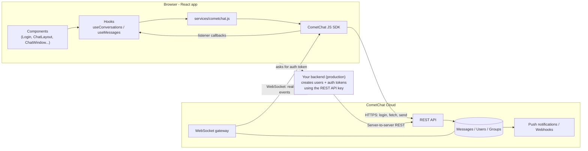
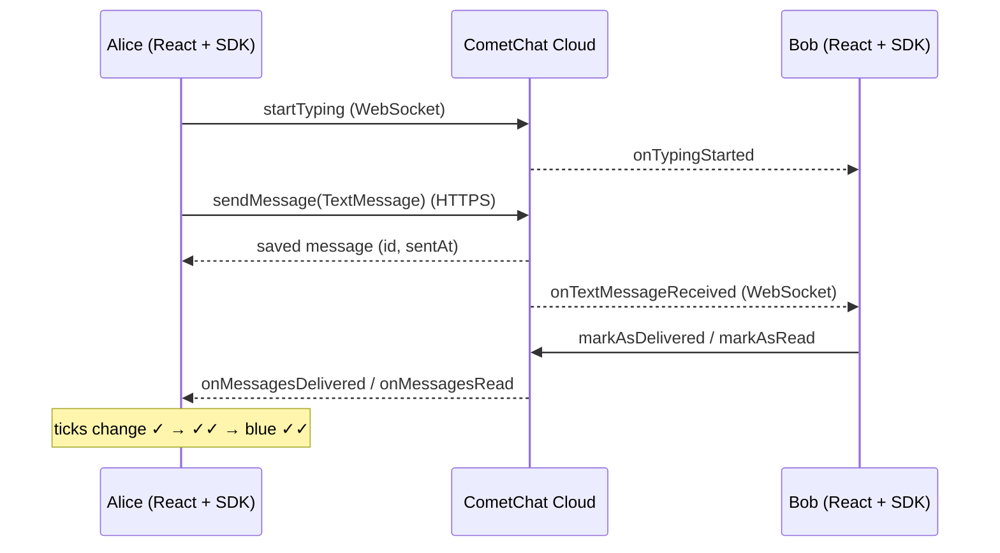
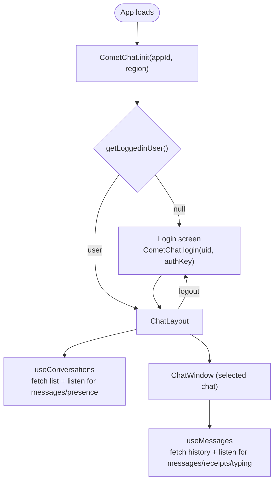

# Architecture

## 1. System overview

CometChat is a hosted chat backend (a "chat-as-a-service" product). It stores users, groups and messages, and
delivers them in real time. Our React app uses the CometChat JavaScript SDK, which
talks to CometChat over two channels:

- **HTTPS (REST)**: login, fetching history, sending messages
- **WebSocket**: real-time events pushed to the client (new messages, typing, receipts, presence)



## 2. Message flow (Alice sends to Bob)



## 3. App lifecycle



## 4. Code layout

```
src/
├── main.jsx                  React root + <AuthProvider>
├── App.jsx                   Picks a screen from the auth state: setup / loading / login / chat
├── services/cometchat.js     The only module that calls the SDK for setup, auth, fetching and sending
├── context/AuthContext.jsx   init + session restore + signIn/signOut
├── hooks/
│   ├── useConversations.js   Sidebar list, unread counts, presence (listener: "conversation-list")
│   └── useMessages.js        Open chat: history, live messages, receipts, typing (listener: "messages-<key>")
├── components/
│   ├── Login.jsx             UID login + the sample users
│   ├── ChatLayout.jsx        Sidebar (Chats / Users tabs) + main pane
│   ├── ConversationList.jsx
│   ├── UserList.jsx          Start a new 1:1 chat
│   ├── ChatWindow.jsx        Header + MessageList + MessageComposer
│   ├── MessageList.jsx       Bubbles, ticks, "load older", scroll handling
│   ├── MessageComposer.jsx   Enter to send, typing indicator start/stop
│   └── Avatar.jsx
└── utils/format.js
```

### Key ideas

- **Chat target**: `{ type: "user" | "group", id, name, avatar, status }`. Its key is `"user:<uid>"` or
  `"group:<guid>"`, and `targetKeyFromMessage()` maps any incoming message to the chat it belongs to.
- **Listeners are the real-time layer.** Each hook registers a listener under a unique ID when it mounts and
  removes it on cleanup. Without the cleanup, you would get duplicate messages.
- **History is pulled, new messages are pushed.** `MessagesRequest.fetchPrevious()` pages backwards through
  history, and listeners add new messages to the end.

## 5. Auth: dev vs production

| | Development (this repo) | Production |
|---|---|---|
| Client login | `CometChat.login(uid, AUTH_KEY)` | `CometChat.login(authToken)` |
| Who creates users | Dashboard / sample users | Your backend via REST API (`POST /users`) |
| Secret on client | Auth Key (anyone can log in as any user) | None. The backend issues per-user tokens |
